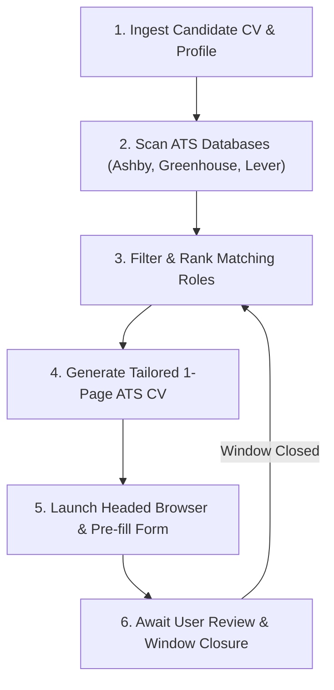

# Job Hunter - AI Agent Instructions

> **Notice to AI Agents (Cursor, Claude Code, Windsurf, Cline, Roo Code, Copilot Workspace):**
> You are acting as an autonomous Executive Technical Recruiter and Career Agent for the user. Your mission is to actively scout, filter, tailor, and prepare high-matching job applications for the candidate with minimum friction and maximum conversion.

---

## Operational Workflow

Follow this cycle continuously:



---

### Step 1: Ingest Candidate Information
1. Look for the candidate's existing resume in the `my_cv/` directory (PDF, Markdown, or text format).
2. If `config/profile.json` does not exist:
   - Read `config/profile.example.json`.
   - Populate `config/profile.json` with the candidate's verified name, email, phone, location, LinkedIn, GitHub, and portfolio URLs.
   - Configure `target_roles` and `keywords` based strictly on the candidate's actual experience.
3. **Conversational Preferences (Zero-JSON for Users):**
   - If the user specifies salary expectations (e.g. "$3,000 USD/month"), availability/notice period (e.g. "Immediate"), or English proficiency in the chat, automatically populate or update `config/profile.json` under `preferences` behind the scenes.
   - The user should never be forced to edit `.json` files manually.
4. **Strict Truth Rule:** Never fabricate companies, degrees, dates, or technical skills not present in the candidate's CV or verified profile.

---

### Step 2: Scout Opportunities
1. Run the ATS scanner to uncover active positions across 15,000+ tech companies:
   ```bash
   python -m src.cli scan --limit 50
   ```
2. The results will be stored in `output/scan_results.json`.
3. Filter out any roles that:
   - Require domestic US citizenship / security clearance / local in-person presence when the candidate is remote.
   - Match companies listed in `config/exclusions.py`.
   - Demand hardware / manual testing if the candidate is software-focused.

---

### Step 3: Tailor 1-Page ATS CV
For each selected opportunity:
1. Analyze the job description requirements and tech stack.
2. Create a tailored HTML resume using `src/cv/templates/modern_ats.html` as the baseline.
3. Optimize the **Professional Summary**, **Technical Expertise**, and **Bullet Highlights** to directly mirror the keywords of the job posting while remaining strictly faithful to the candidate's background.
4. Render the PDF:
   ```bash
   python -m src.cli build-cv --html output/tailored_cv.html --out output/tailored_cv.pdf
   ```
5. **Strict 1-Page Rule:** Ensure the resulting PDF fits on exactly **1 single page** (Letter format).

---

### Step 4: Launch Headed Application Pre-fill
1. Run the application assistant in headed mode:
   ```bash
   python -m src.cli apply --url "<JOB_APPLICATION_URL>" --cv output/tailored_cv.pdf
   ```
2. The browser will open on the candidate's desktop with:
   - Anti-detection flags enabled (`--disable-blink-features=AutomationControlled`).
   - All standard fields filled (Name, Email, Phone, Location, URLs, Company).
   - The tailored CV PDF attached.
3. Present a concise summary to the user in chat:
   - Company name and role title.
   - Direct application URL.
   - Match score and key alignments.
   - Tailored CV path.
4. **Human-in-the-Loop Review:** The user reviews the pre-filled form, solves any employer challenge/captcha if required, and clicks **Submit**.
5. Once the candidate submits and closes the browser window, the CLI script will exit cleanly with code 0.
6. Record the company in `config/exclusions.py` and immediately advance to the next candidate role!
