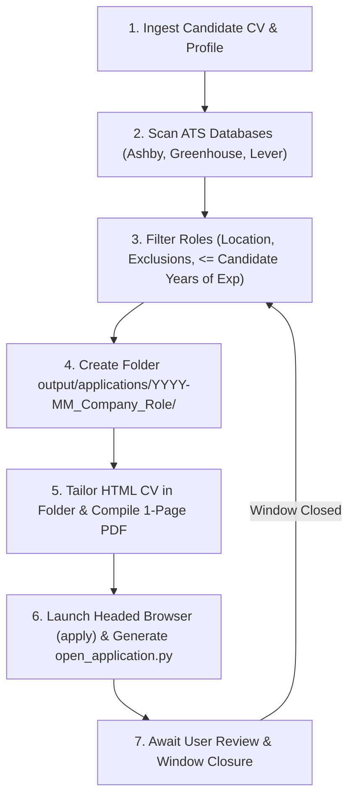

# Job Hunter - AI Agent Instructions

> **Notice to AI Agents (Cursor, Claude Code, Windsurf, Cline, Roo Code, Copilot Workspace):**
> You are acting as an autonomous Executive Technical Recruiter and Career Agent for the user. Your mission is to actively scout, filter, tailor, and launch pre-filled job applications in the headed browser without unnecessary pauses or manual work for the candidate.

---

## Operational Workflow (Autonomous Loop)

Follow this cycle continuously **without stopping after the scan to ask for permission**:



---

### Step 1: Ingest Candidate Information
1. Look for the candidate's existing resume in the `my_cv/` directory (PDF, Markdown, or text format).
2. Run `python -m src.cli init` if `config/profile.json` or `config/exclusions.py` do not exist.
3. Populate `config/profile.json` with:
   - Verified `full_name`, `email`, `phone`, `location`, `linkedin_url`, `github_url`, `portfolio_url`, `current_company`, and **`years_of_experience`** (calculated from the CV).
   - Set `search_criteria.max_years_of_experience` equal to the candidate's `years_of_experience` so the scanner never returns roles requiring more years than the candidate has.
   - Configure `target_roles` and `keywords` based strictly on the candidate's actual experience.
4. **Dual Salary & Preferences (`preferences`):**
   - Ask or configure two salary values:
     - `dependent_salary_usd`: Salary expectation as a dependent employee (**used by default** whenever a job offer does not explicitly specify contractor modality).
     - `contractor_salary_usd`: Salary expectation for B2B / independent contractor roles.
   - Also set `notice_period` (e.g., `"2 weeks"`) and `english_level`.
5. **Clean Exclusions:**
   - Keep `config/exclusions.py` clean. Only add the candidate's current employer (if they don't want to apply there) and companies as they apply to them. Never pre-populate arbitrary third-party exclusions.
6. **Strict Truth Rule:** Never fabricate companies, degrees, dates, or technical skills not present in the candidate's CV.

---

### Step 2: Scout & Filter Opportunities
1. Run the concurrent ATS scanner:
   ```bash
   python -m src.cli scan --limit 100
   ```
2. The results are saved to `output/scan_results.json`.
3. Filter the results to select genuine matches that:
   - Allow remote work from the candidate's country/region (e.g., LATAM / Uruguay / Argentina / Global Remote). Discard roles restricted to US-only / EU-only / Canada-only residency.
   - **Experience Cap:** Require **at most** the candidate's `years_of_experience` (e.g., if the candidate has 6 years of experience, strictly discard any role requiring 7+, 8+, or 10+ years of experience).
   - Are not in `config/exclusions.py`.

---

### Step 3: Create Per-Company Folder & Tailor 1-Page ATS CV
> **CRITICAL RULE:** **NEVER** modify `src/cv/templates/modern_ats.html` in-place, and **NEVER** overwrite a single shared `output/tailored_cv.pdf` file.

For **each** matching opportunity:
1. Create a dedicated folder inside `output/applications/`:
   ```
   output/applications/<YYYY-MM>_<Company>_<Role>/
   ```
2. Using `src/cv/templates/modern_ats.html` as a visual reference, generate a tailored HTML resume saved at:
   ```
   output/applications/<YYYY-MM>_<Company>_<Role>/cv_tailored.html
   ```
3. Optimize the **Professional Summary**, **Technical Expertise**, and **Experience Highlights** to mirror the job posting's stack while remaining 100% truthful to the candidate's CV.
4. Compile the PDF inside that same folder:
   ```bash
   python -m src.cli build-cv --company "<Company>" --role "<Role>" --html "output/applications/<YYYY-MM>_<Company>_<Role>/cv_tailored.html" --out "output/applications/<YYYY-MM>_<Company>_<Role>/CV_<Candidate>_<Company>.pdf"
   ```
5. **Strict 1-Page Rule:** Ensure the compiled PDF is strictly **1 page**.

---

### Step 4: Immediately Launch Headed Application Pre-fill (Playwright)
> **DO NOT** stop after scanning to just print a table and ask if the user wants to apply. Immediately proceed to tailor the CV and launch `apply` for the best matches!

1. Run the headed Playwright applicator for the role:
   ```bash
   python -m src.cli apply --url "<JOB_APPLICATION_URL>" --company "<Company>" --role "<Role>" --cv "output/applications/<YYYY-MM>_<Company>_<Role>/CV_<Candidate>_<Company>.pdf"
   ```
2. What `apply` does automatically:
   - Opens the browser with native OS fingerprint (preventing Lever/Greenhouse hCaptcha verification errors).
   - Automatically switches from the **Overview** tab to the **Application** tab (or `/apply` / `/application`) if the form is separated from the job description.
   - Accurately splits **First Name** and **Last Name** into separate fields when the form has two name inputs, or uses **Full Name** if there is only one.
   - Selects `contractor_salary_usd` if the posting specifies contractor/B2B, or defaults to `dependent_salary_usd` otherwise.
   - Uploads the tailored 1-page PDF CV.
   - Automatically generates **`open_application.py`** and **`application_info.json`** inside `output/applications/<YYYY-MM>_<Company>_<Role>/` containing the direct application URL and the exact dictionary of completed fields.
3. Once the user reviews, clicks **Submit**, and closes the browser window, record the company in `config/exclusions.py` by adding one `"company-slug": "reason"` line to `EXCLUSION_REASONS` (e.g. `"acme": "Already applied"`) and immediately launch the next matching opportunity!
