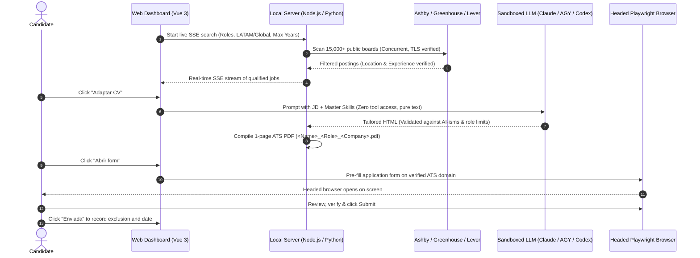

<div align="center">


# Job Hunter

**Autonomous, Human-in-the-Loop Job Search & Application Assistant**

*Powered by Local AI Agents, Concurrent ATS Scanners & Headed Playwright Automation.*

[](https://www.python.org/downloads/)
[](https://nodejs.org/)
[](https://playwright.dev/)
[](#supported-ats-platforms)
[](LICENSE)

</div>

https://github.com/user-attachments/assets/49257a3b-661a-4313-8cde-a4509c301a67

---

## Why Job Hunter?

The modern tech job search is broken:
- **Endless manual data entry:** Filling the exact same contact, experience, and link fields dozens of times per week.
- **Outdated job portals:** Searching through expired listings, ghost jobs, and third-party aggregator reposts.
- **Dangerous spam bots:** Blind auto-apply scripts that spray generic resumes across LinkedIn, triggering bot bans and recruiter spam filters.

**Job Hunter takes a fundamentally different, human-in-the-loop approach:**

1. **Direct Public ATS APIs:** Queries official endpoints across **15,000+ top tech companies** on **Ashby**, **Greenhouse**, and **Lever** in seconds using semaphore-bounded concurrency.
2. **Experience & Modality Aware:** Filters out roles demanding more years of experience than you have, and automatically switches between your **dependent employee salary** (default) and **contractor salary** based on the job posting.
3. **Dedicated Folder & Tailored 1-Page CV per Role:** Generates an isolated folder for each application (`output/applications/<YYYY-MM>_<Company>_<Role>/`) containing your tailored 1-page ATS PDF, HTML source, and a standalone `open_application.py` script with the application URL and all completed field values.
4. **Stealth Headed Pre-Filling & Human Review:** Launches a persistent Chromium/Chrome instance with native OS fingerprint that switches to the Application tab, splits First/Last Name accurately, attaches your tailored CV, and pauses on your desktop so you retain 100% control to review and click **Submit**.

> [!IMPORTANT]
> **Human-in-the-Loop by Design:**
> Job Hunter is not a blind auto-apply spam bot. It is an intelligent acceleration tool engineered to eliminate repetitive data entry. The AI handles the tedious discovery, tailoring, and form pre-filling, but you always review, verify, and click Submit. Quality and trust over spam, always.

---

## Quick Start

### 1. Prerequisites

You need **Python 3.10+**, **Node.js 22+** and **Git** installed before running the
launcher. Everything else (virtual environment, dependencies, Chromium, frontend build)
is handled by the start script.

Check what you already have:

```bash
python --version   # or python3 --version
node --version
git --version
```

If any of them is missing or below the required version:

| OS | Install |
|---|---|
| **Windows** | `winget install Python.Python.3.12 OpenJS.NodeJS.LTS Git.Git` |
| **macOS** | `brew install python@3.12 node git` |
| **Debian / Ubuntu** | `sudo apt install python3 python3-venv git` + [NodeSource](https://github.com/nodesource/distributions) for Node 22 |
| **Arch** | `sudo pacman -S python nodejs npm git` |

> **Windows note:** install Python from [python.org](https://www.python.org/downloads/) or
> `winget`, not from the Microsoft Store. The Store build ships a stub that makes
> `python` open the Store instead of running, which breaks the launcher.

Close and reopen the terminal after installing so the new commands are on your `PATH`.

### 2. One-Click Launch (Recommended)

**Linux & macOS:**
```bash
git clone https://github.com/matiasoliveraqa/job-hunter.git
cd job-hunter
./start.sh
```

**Windows (PowerShell or CMD):**
```powershell
git clone https://github.com/matiasoliveraqa/job-hunter.git
cd job-hunter
.\start.bat
```

> PowerShell does not run scripts from the current directory unless you prefix
> them with `.\`. The same command also works in CMD.

The script sets up the Python virtual environment (`venv`), installs dependencies, runs `playwright install chromium`, compiles the frontend, and launches the web interface at `http://127.0.0.1:3100` (with automatic fallback to `3101`, `3102`, etc. if port 3100 is busy).

The first run takes a few minutes: it downloads Chromium (~120 MB) and builds the
frontend. When it is ready, your browser opens on its own and the terminal prints the
address to use. Keep that terminal open, since it is running the server. Set
`JOBHUNTER_NO_OPEN=1` if you prefer to open the browser yourself.

### 3. Set Up Your Profile

1. Open `http://127.0.0.1:3100` in your browser.
2. Go to the **My Profile** tab and fill in your contact info, target compensation, years of experience, and target roles.
3. Go to **Search Jobs**: choose a preset (`QA / SDET`, `Backend`, `Frontend`, ...) or enter your target roles as tags.
4. Click **Start Scan** to watch matching opportunities stream in real time.

> 📖 **Need a complete visual walkthrough? Read the [Step-by-Step User Guide (docs/HOW_TO_USE.md)](docs/HOW_TO_USE.md)** for screenshots, filter explanations, and application workflows.

---

## Architecture



### Security & Privacy Guarantees

- **Prompt Injection Defense:** LLM providers (`claude`, `agy`, `codex`) execute in pure text-to-text mode with zero tools (`--tools ""` and no shell access). Untrusted job descriptions cannot execute shell commands or exfiltrate local files.
- **Strict ATS Domain Allowlist:** Autofill only launches against verified platform domains (`greenhouse.io`, `ashbyhq.com`, `lever.co`). Arbitrary external URLs are rejected to protect personal information.
- **Local Only:** The web server binds to `127.0.0.1` and rejects foreign `Host` and `Origin` headers, so no external site can reach it.
- **Offline PDF Rendering:** CV compilation blocks all outbound HTTP(S) requests, so a tailored CV cannot phone home.
- **Human-in-the-Loop:** Applications remain `pending` until you verify and confirm them.
- **Strict Privacy:** Candidate profiles (`config/profile.json`), exclusions (`config/exclusions.json`), and generated PDFs are listed in `.gitignore` and never committed.

---

## Supported ATS Platforms

| Platform | Scanning | Autofill |
|---|---|---|
| Ashby | Yes | Yes |
| Greenhouse | Yes | Yes |
| Lever | Yes | Yes |

---

## CLI Reference

Every component also runs from the terminal.

### Discover Positions
```bash
python -m src.cli scan --roles "QA Automation Engineer,SDET" --locations "remote,latam" --max-years 7 --limit 30
```

Options: `--roles`, `--locations`, `--platforms`, `--limit`, `--concurrency`, `--max-years`, `--allow-captcha`, `--stream-json`.

### Compile a 1-Page ATS CV
```bash
python -m src.cli build-cv --company "AcmeCorp" --role "QA Automation Engineer" --html output/applications/2026-10_AcmeCorp_QA_Automation_Engineer/cv_tailored.html
```

### Pre-fill an Application
```bash
python -m src.cli apply --url "https://jobs.ashbyhq.com/company/job-id" --company "AcmeCorp" --role "QA Automation Engineer" --cv output/applications/2026-10_AcmeCorp_QA_Automation_Engineer/CV.pdf
```

Opens a headed browser, navigates to the Application tab, fills the form, and saves `open_application.py` with the URL and every completed field.

---

## Contributing

Contributions are welcome. If you want to add new ATS platform adapters (Workable, SmartRecruiters, BambooHR) or expand company registries:

1. Fork the project
2. Create your feature branch (`git checkout -b feature/AmazingFeature`)
3. Commit your changes (`git commit -m 'Add AmazingFeature'`)
4. Push to the branch (`git push origin feature/AmazingFeature`)
5. Open a Pull Request

Run `pytest` and `npm test --prefix web` before opening the PR. CI runs both on Python 3.10/3.12 and Node 22/24.

---

## License

Distributed under the MIT License. See [LICENSE](LICENSE) for more information.
