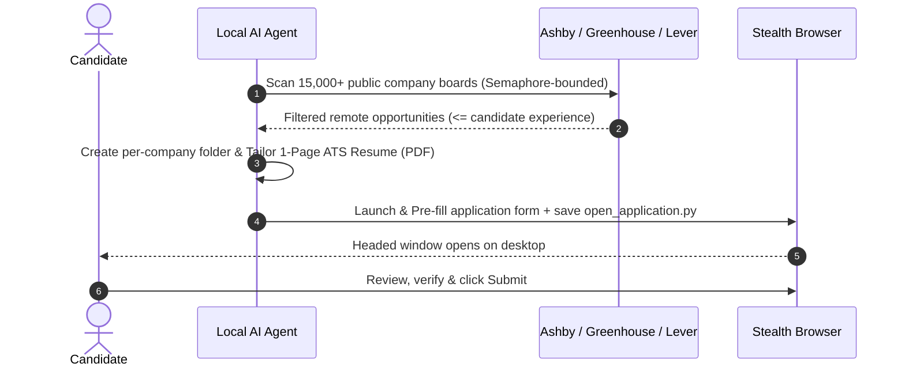

# Job Hunter

**Autonomous, Human-in-the-Loop Job Search & Application Assistant**  
*Powered by Local AI Agents, Concurrent ATS Scanners & Headed Playwright Automation.*

[](https://www.python.org/downloads/)
[](https://playwright.dev/)
[](#supported-ats-platforms)
[](LICENSE)

---

## Why Job Hunter?

The modern tech job search is broken:
- **Endless manual data entry:** Filling the exact same contact, experience, and link fields dozens of times per week.
- **Outdated job portals:** Searching through expired listings, ghost jobs, and third-party aggregator reposts.
- **Dangerous spam bots:** Blind auto-apply scripts that spray generic resumes across LinkedIn, triggering bot bans and recruiter spam filters.

**Job Hunter takes a fundamentally different, human-in-the-loop approach:**
1. **Direct Public ATS APIs:** Queries official endpoints across **15,000+ top tech companies** on **Ashby**, **Greenhouse**, and **Lever** in seconds using semaphore-bounded concurrency.
2. **Experience & Modality Aware:** Filters out roles demanding more years of experience than you have, and automatically switches between your **dependent employee salary** (default) and **contractor salary** based on the job posting.
3. **Dedicated Folder & Tailored 1-Page CV per Role:** Generates an isolated folder for each application (`output/applications/<YYYY-MM>_<Company>_<Role>/`) containing your tailored 1-page ATS PDF, HTML source, and a standalone `open_application.py` script with the application URL and all completed field values.
4. **Stealth Headed Pre-Filling & Human Review:** Launches a persistent Chromium/Chrome instance with native OS fingerprint that switches to the Application tab, splits First/Last Name accurately, attaches your tailored CV, and pauses on your desktop so you retain 100% control to review and click **Submit**.

---

## Architecture



> [!IMPORTANT]
> **Human-in-the-Loop by Design:**  
> Job Hunter is not a blind auto-apply spam bot. It is an intelligent acceleration tool engineered to eliminate repetitive data entry. The AI handles the tedious discovery, tailoring, and form pre-filling, but you always review, verify, and click Submit. Quality and trust over spam, always.

---

## Quick Start

### 1. Prerequisites
- **Python 3.10+**
- Recommended: A terminal-capable AI Assistant (**Cursor**, **Claude Code**, **Windsurf**, **Cline**, **Roo Code**, or local LLM agent).

### 2. Installation
Clone this repository and set up a virtual environment:

**Windows (PowerShell / CMD / Git Bash):**
```powershell
git clone https://github.com/matiasoliveraqa/job-hunter.git
cd job-hunter

python -m venv venv
venv\Scripts\activate

pip install -r requirements.txt
playwright install chromium
```

**Linux & macOS:**
```bash
git clone https://github.com/matiasoliveraqa/job-hunter.git
cd job-hunter

python3 -m venv venv
source venv/bin/activate

pip install -r requirements.txt
playwright install chromium
```

### 3. Initialize Configuration
Run the setup command to generate your local configuration:

```bash
python -m src.cli init
```

This creates:
- `config/profile.json`: Fill this with your personal details, `years_of_experience`, target roles, and dual salary expectations (`dependent_salary_usd` and `contractor_salary_usd`).
- `config/exclusions.py`: Companies or recruitment agencies you wish to skip, as `"slug": "reason"` entries in `EXCLUSION_REASONS`.

---

## Using with AI Coding Assistants

Job Hunter is engineered to be **LLM-agnostic**. It includes:
- `AGENT_INSTRUCTIONS.md`: Standardized instructions for autonomous execution.
- `.claude/settings.json`: Pre-configured CLI permissions so **Claude Code** can run `scan`, `build-cv`, and `apply` out-of-the-box without permission blocks.

### Example Workflow with Cursor / Claude Code / Windsurf:
1. Place your current master resume (PDF or Markdown) in `my_cv/`.
2. Open the project folder in your AI editor.
3. In the agent chat, prompt:
   > *"Read `AGENT_INSTRUCTIONS.md`, configure my profile from `my_cv/`, and start applying to matching remote opportunities."*
4. Your agent will automatically:
   - Extract your skills and years of experience into `config/profile.json`.
   - Scan the ATS registries for matching positions that do not exceed your years of experience.
   - Create a dedicated folder per company under `output/applications/<YYYY-MM>_<Company>_<Role>/` with a tailored 1-page ATS PDF.
   - Immediately launch the headed browser on your screen with all fields filled and save `open_application.py` with the job URL and field log.
5. Review the application on your screen, click **Submit**, and close the window!

---

## CLI Reference

You can also run all components manually via the CLI:

### Discover Positions
```bash
# Scan across Ashby, Greenhouse, and Lever for remote roles matching your experience
python -m src.cli scan --roles "Software Engineer,Full Stack" --locations "remote,latam" --max-years 6 --limit 30
```

### Compile a 1-Page ATS CV (Per-Company Folder)
```bash
python -m src.cli build-cv --company "AcmeCorp" --role "Senior_Engineer" --html output/applications/2026-10_AcmeCorp_Senior_Engineer/cv_tailored.html
```

### Pre-fill an Application
```bash
# Opens headed browser, navigates to Application tab, fills form, and saves open_application.py
python -m src.cli apply --url "https://jobs.ashbyhq.com/company/job-id" --company "AcmeCorp" --role "Senior_Engineer" --cv output/applications/2026-10_AcmeCorp_Senior_Engineer/CV_AcmeCorp.pdf
```

---

## Security & Privacy Guarantee

- **100% Local Execution:** No third-party servers, tracking pixels, or remote database logging.
- **Strict Git Protection:** `.gitignore` comes pre-configured to strictly ignore `config/profile.json`, `config/exclusions.py`, `my_cv/`, `output/`, generated PDFs, and browser profiles. Your personal details will never be accidentally pushed to GitHub.
- **Native OS Anti-Bot Evasion:** Launches persistent Chrome/Chromium sessions preserving your native OS User-Agent and platform while masking `navigator.webdriver`, preventing false-positive hCaptcha/Cloudflare verification errors on Lever, Greenhouse, and Ashby.

---

## Contributing

Contributions are welcome! If you want to add new ATS platform adapters (e.g., Workable, SmartRecruiters, BambooHR) or expand company registries:
1. Fork the Project
2. Create your Feature Branch (`git checkout -b feature/AmazingFeature`)
3. Commit your Changes (`git commit -m 'Add AmazingFeature'`)
4. Push to the Branch (`git push origin feature/AmazingFeature`)
5. Open a Pull Request

---

## License

Distributed under the MIT License. See [LICENSE](LICENSE) for more information.
