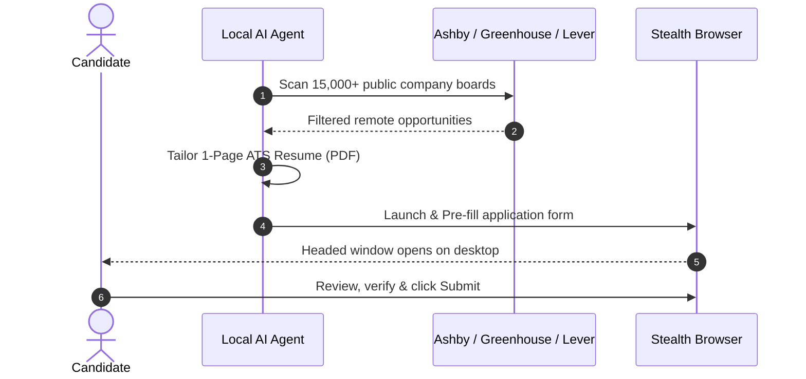

# Job Hunter

**Autonomous, Human-in-the-Loop Job Search & Application Assistant**  
*Powered by Local AI Agents, Concurrent ATS Scanners & Headed Playwright Automation.*

[](https://www.python.org/downloads/)
[](https://playwright.dev/)
[](#supported-ats-platforms)
[](LICENSE)

</div>

---

## Why Job Hunter?

The modern tech job search is broken:
- **Endless manual data entry:** Filling the exact same contact, experience, and link fields dozens of times per week.
- **Outdated job portals:** Searching through expired listings, ghost jobs, and third-party aggregator reposts.
- **Dangerous spam bots:** Blind auto-apply scripts that spray generic resumes across LinkedIn, triggering bot bans and recruiter spam filters.

**Job Hunter takes a fundamentally different, human-in-the-loop approach:**
1. **Direct Public ATS APIs:** Queries official endpoints across **15,000+ top tech companies** on **Ashby**, **Greenhouse**, and **Lever** in seconds.
2. **Fact-Grounded Dynamic Resumes:** Generates tailored, strictly 1-page ATS-compliant PDF resumes that match job criteria without hallucinating experience.
3. **Stealth Headed Pre-Filling:** Launches an anti-detection Chromium instance that fills the application, attaches your tailored CV, and pauses on your desktop.
4. **Human Review & One-Click Submit:** You retain 100% control to review, solve any employer challenges, and click **Submit**.

---

## Architecture



> [!IMPORTANT]
> **Human-in-the-Loop by Design:**  
> Job Hunter is not a blind auto-apply spam bot. It is an intelligent acceleration tool engineered to eliminate repetitive data entry. The AI handles the tedious discovery, tailoring, and form pre-filling, but you always review, verify, and click Submit. Quality and trust over spam, always.

---

## Quick Start

### 1. Prerequisites
- **Python 3.10+**
- Recommended: A terminal-capable AI Assistant (**Cursor**, **Claude Code**, **Windsurf**, **Cline**, **Roo Code**, or local LLM agent).

### 2. Installation
Clone this repository and set up a virtual environment:

```bash
git clone https://github.com/your-username/job-hunter.git
cd job-hunter

python3 -m venv venv
source venv/bin/activate  # On Windows: venv\Scripts\activate

pip install -r requirements.txt
playwright install chromium
```

### 3. Initialize Configuration
Run the setup command to generate your local configuration:

```bash
python -m src.cli init
```

This creates:
- `config/profile.json`: Fill this with your personal details, target roles, technical keywords, and location preferences.
- `config/exclusions.py`: Add any companies or recruitment agencies you wish to skip.

---

## Using with AI Coding Assistants

Job Hunter is engineered to be **LLM-agnostic**. It includes a standardized prompt file (`AGENT_INSTRUCTIONS.md`) designed for autonomous agents.

### Example Workflow with Cursor / Claude Code / Windsurf:
1. Place your current master resume (PDF or Markdown) in `my_cv/`.
2. Open the project folder in your AI editor.
3. In the agent chat, prompt:
   > *"Read `AGENT_INSTRUCTIONS.md`, configure my profile from `my_cv/`, and start searching for remote opportunities."*
4. Your agent will automatically:
   - Extract your skills into `config/profile.json`.
   - Scan the ATS registries for matching positions.
   - Tailor your resume into an ATS single-page PDF.
   - Launch the headed browser on your screen with all fields filled.
5. Review the application on your screen, click **Submit**, and close the window. The agent will immediately proceed to the next high-match position!

---

## CLI Reference

You can also run all components manually via the CLI:

### Discover Positions
```bash
# Scan across Ashby, Greenhouse, and Lever for remote roles
python -m src.cli scan --roles "Software Engineer,Full Stack" --locations "remote,latam" --limit 30
```

### Compile a 1-Page ATS CV
```bash
python -m src.cli build-cv --html output/my_cv.html --out output/my_cv.pdf
```

### Pre-fill an Application
```bash
# Opens headed browser with stealth anti-detection
python -m src.cli apply --url "https://jobs.ashbyhq.com/company/job-id/application" --cv output/my_cv.pdf
```

---

## Security & Privacy Guarantee

- **100% Local Execution:** No third-party servers, tracking pixels, or remote database logging.
- **Strict Git Protection:** `.gitignore` comes pre-configured to strictly ignore `config/profile.json`, `my_cv/`, generated PDFs, and application logs. Your personal details will never be accidentally pushed to GitHub.
- **Anti-Bot Evasion:** Launches Chromium instances with `navigator.webdriver` masked and `--disable-blink-features=AutomationControlled` to avoid false-positive bot flags on recruitment portals.

---

## Contributing

Contributions are welcome! If you want to add new ATS platform adapters (e.g., Workable, SmartRecruiters, BambooHR) or expand company registries:
1. Fork the Project
2. Create your Feature Branch (`git checkout -b feature/AmazingFeature`)
3. Commit your Changes (`git commit -m 'Add AmazingFeature'`)
4. Push to the Branch (`git push origin feature/AmazingFeature`)
5. Open a Pull Request

---

## License

Distributed under the MIT License. See [LICENSE](LICENSE) for more information.
