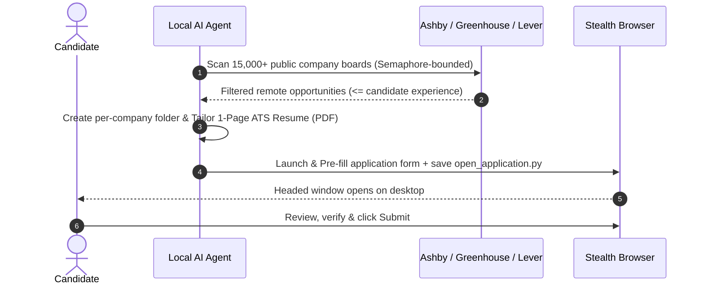
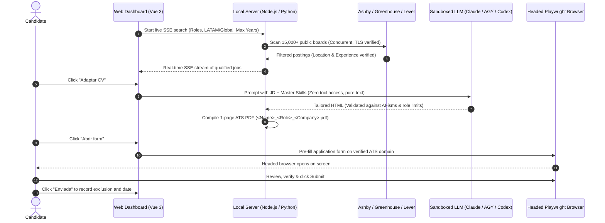

# Job Hunter

**Autonomous, Human-in-the-Loop Job Search & Application Assistant**  
*Powered by Local AI Agents, Concurrent ATS Scanners & Headed Playwright Automation.*

[](https://www.python.org/downloads/)
[](https://playwright.dev/)
[](#supported-ats-platforms)
[](LICENSE)

---

## Why Job Hunter?

The modern tech job search is broken:
- **Endless manual data entry:** Filling the exact same contact, experience, and link fields dozens of times per week.
- **Outdated job portals:** Searching through expired listings, ghost jobs, and third-party aggregator reposts.
- **Dangerous spam bots:** Blind auto-apply scripts that spray generic resumes across LinkedIn, triggering bot bans and recruiter spam filters.

**Job Hunter takes a fundamentally different, human-in-the-loop approach:**
1. **Direct Public ATS APIs:** Queries official endpoints across **15,000+ top tech companies** on **Ashby**, **Greenhouse**, and **Lever** in seconds using semaphore-bounded concurrency.
2. **Experience & Modality Aware:** Filters out roles demanding more years of experience than you have, and automatically switches between your **dependent employee salary** (default) and **contractor salary** based on the job posting.
3. **Dedicated Folder & Tailored 1-Page CV per Role:** Generates an isolated folder for each application (`output/applications/<YYYY-MM>_<Company>_<Role>/`) containing your tailored 1-page ATS PDF, HTML source, and a standalone `open_application.py` script with the application URL and all completed field values.
4. **Stealth Headed Pre-Filling & Human Review:** Launches a persistent Chromium/Chrome instance with native OS fingerprint that switches to the Application tab, splits First/Last Name accurately, attaches your tailored CV, and pauses on your desktop so you retain 100% control to review and click **Submit**.

---

## Architecture



> [!IMPORTANT]
> **Human-in-the-Loop by Design:**  
> Job Hunter is not a blind auto-apply spam bot. It is an intelligent acceleration tool engineered to eliminate repetitive data entry. The AI handles the tedious discovery, tailoring, and form pre-filling, but you always review, verify, and click Submit. Quality and trust over spam, always.

---

## Quick Start (Web App & One-Click Launch)

### 1. Prerequisites
- **Python 3.10+**
- **Node.js 18+**

### 2. One-Click Launch (Recommended)

**Linux & macOS:**
```bash
git clone https://github.com/matiasoliveraqa/job-hunter.git
cd job-hunter
./start.sh
```

**Windows:**
```bat
git clone https://github.com/matiasoliveraqa/job-hunter.git
cd job-hunter
start.bat
```

The script sets up the Python virtual environment (`venv`), installs dependencies, runs `playwright install chromium`, compiles the frontend, and launches the web interface at `http://127.0.0.1:3100` (with automatic fallback to `3101`, `3102`, etc. if port 3100 is busy).

### 3. Setup Your Profile

1. Open `http://127.0.0.1:3100` in your browser.
2. Go to the **Mi perfil** tab.
3. Fill in your contact info, target compensation, years of experience, and target roles.
4. Go to **Buscar vacantes**: choose a preset (e.g. `QA / SDET`, `Backend`, `Frontend`) or enter your target roles as tags.
5. Click **Buscar vacantes** to watch opportunities stream in real time.

---

## Architecture & Security Model



### Security & Privacy Guarantees
- **Prompt Injection Defense:** LLM providers (`claude`, `agy`, `codex`) execute in pure text-to-text mode with zero tools (`--tools ""` and no shell access). Untrusted job descriptions cannot execute shell commands or exfiltrate local files.
- **Strict ATS Domain Allowlist:** Autofill only launches against verified platform domains (`greenhouse.io`, `ashbyhq.com`, `lever.co`). Arbitrary external URLs are rejected to protect personal information.
- **Dynamic Port Allocation:** The local web server automatically detects port conflicts on 3100 and switches to the next available port.
- **Human-in-the-Loop:** Applications remain `pending` until you verify and confirm them.
- **Strict Privacy:** Candidate profiles (`config/profile.json`), exclusions (`config/exclusions.json`), and generated PDFs are kept in `.gitignore` and never committed.

---

## CLI Reference

You can also run all components manually via the terminal:

### Discover Positions
```bash
# Scan across Ashby, Greenhouse, and Lever for remote roles matching your experience
python -m src.cli scan --roles "QA Automation Engineer,SDET" --locations "remote,latam" --max-years 7 --limit 30
```

### Compile a 1-Page ATS CV
```bash
python -m src.cli build-cv --company "AcmeCorp" --role "QA_Automation_Engineer" --html output/applications/2026-10_AcmeCorp_QA_Automation_Engineer/cv_tailored.html
```

### Pre-fill an Application
```bash
# Opens headed browser, navigates to Application tab, fills form, and saves open_application.py
python -m src.cli apply --url "https://jobs.ashbyhq.com/company/job-id" --company "AcmeCorp" --role "QA_Automation_Engineer" --cv output/applications/2026-10_AcmeCorp_QA_Automation_Engineer/CV.pdf
```

---

## Contributing

Contributions are welcome! If you want to add new ATS platform adapters (e.g., Workable, SmartRecruiters, BambooHR) or expand company registries:
1. Fork the Project
2. Create your Feature Branch (`git checkout -b feature/AmazingFeature`)
3. Commit your Changes (`git commit -m 'Add AmazingFeature'`)
4. Push to the Branch (`git push origin feature/AmazingFeature`)
5. Open a Pull Request

---

## License

Distributed under the MIT License. See [LICENSE](LICENSE) for more information.
