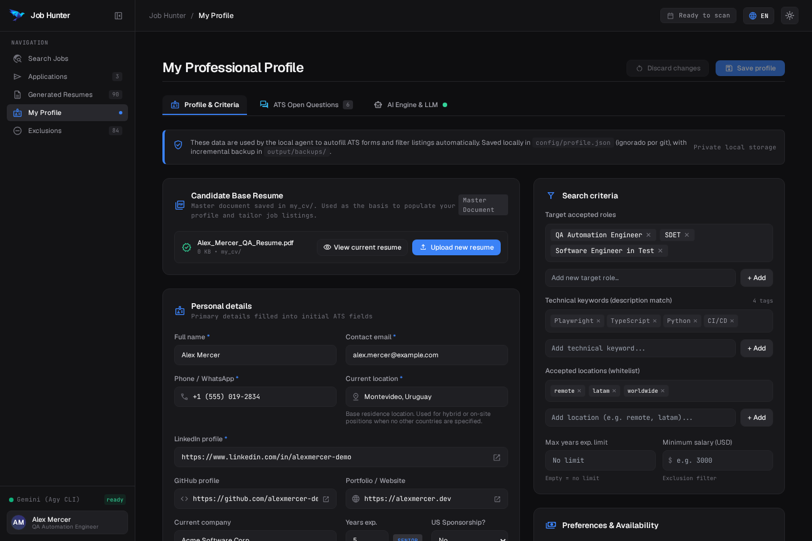
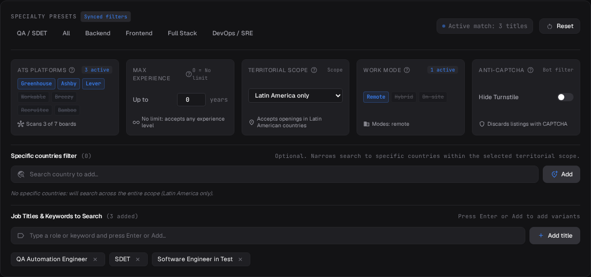
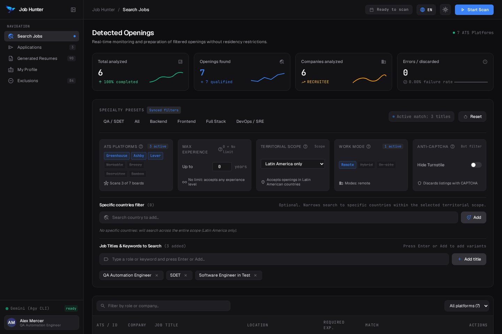
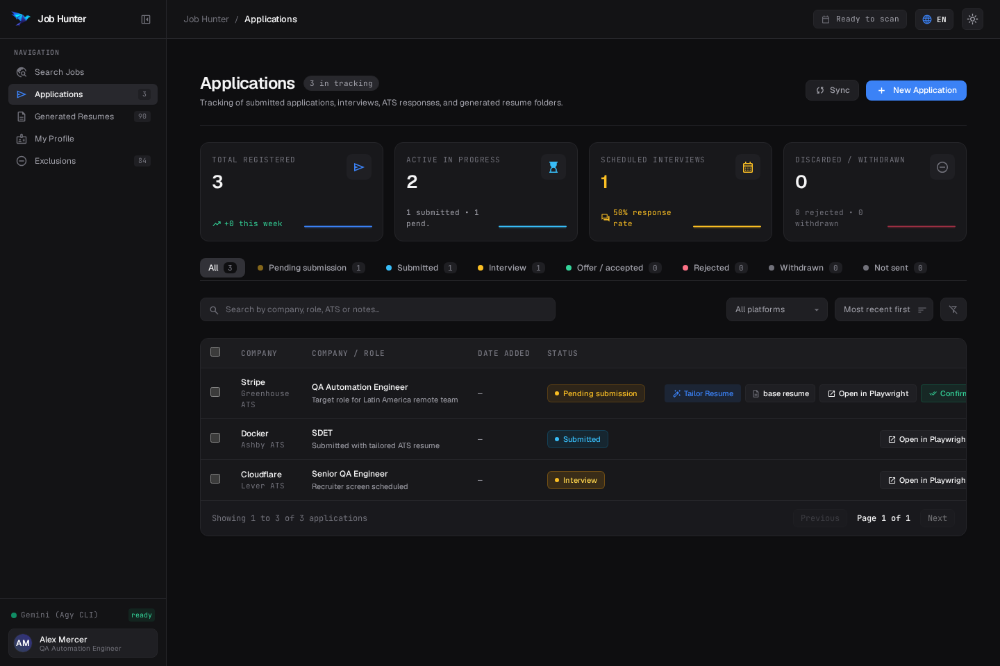

# Job Hunter: End-to-End User Guide

This guide walks you through every step of Job Hunter, from initial setup to submitting your first verified job application.

---

## 1. Core Philosophy: Human-in-the-Loop

Job Hunter does not spray generic resumes across the web. Instead, it handles the repetitive parts of the job search:
- Scanning official ATS endpoints directly (Ashby, Greenhouse, Lever).
- Filtering out positions that require work authorization or location criteria you do not meet.
- Generating a tailored 1-page ATS resume formatted specifically for the target job description.
- Pre-filling your personal details, links, salary expectations, and open-ended questions in a visible Chromium browser.

**You retain full control.** A browser window opens on your screen, fills the form fields in front of you, and pauses. You review the filled inputs, verify all answers, and click **Submit** yourself.

---

## 2. Step 1: Initial Profile Setup

When you first open `http://127.0.0.1:3100`, navigate to the **My Profile** (`Mi perfil`) view from the left sidebar.



### Personal Information
- **Full Name, Contact Email & Phone**: Used on ATS contact fields.
- **Current Location (City, Country)**: Type your city or country. An autocomplete dropdown suggests normalized options (for example `Montevideo, Uruguay` or `Berlin, Germany`). You can also type custom locations.
- **LinkedIn, GitHub, Portfolio**: Pre-filled automatically on ATS link fields.

### Compensation & Preferences
- **Dependent Salary (USD / month)**: Standard monthly salary for employee payroll.
- **Contractor Salary (USD / month)**: B2B or contractor monthly rate. Job Hunter checks whether the job description specifies a contractor role and selects the appropriate rate.

### Base Resume
- Upload your primary PDF resume in the **Base Resume** section (e.g. `Alex_Mercer_QA_Resume.pdf`).
- The system extracts your work history, projects, and skills to provide the master template for application tailoring.

Click **Save** (`Guardar`) at the bottom of the page to save your profile configuration to `config/profile.json`.

---

## 3. Step 2: Configuring Search & Filters

Navigate to **Search Jobs** (`Buscar vacantes`) in the navigation bar.



The search control panel contains 5 parameter cards and a country filter:

### 1. ATS Platforms
Toggle **Greenhouse**, **Ashby**, and **Lever**. You can enable any combination, but at least one must stay active.

### 2. Max Experience Filter
- **Default value: `0`**.
- When set to `0`, the system disables experience filtering and accepts any required years.
- When set to a positive integer (e.g. `5`), the scanner discards postings that demand more than that number of years.

### 3. Territorial Scope (`Alcance Territorial`)
Select the geographical region:
- **Latin America only (`latam`)**: Accepts vacancies in Latin America. Discards postings exclusive to the US, Europe, or Asia.
- **LATAM + North America (`latam_na`)**: Accepts positions across Latin America, the United States, and Canada.
- **Global (`global`)**: Accepts job postings from any country worldwide.

### 4. Work Modes (`Modalidad`)
Activate one or more modes:
- **Remote (`Remoto`)**: Distributed and home-office postings.
- **Hybrid (`Híbrido`)**: Positions requiring partial office presence.
- **On-site (`Presencial`)**: Physical office roles. In Global scope, accepts on-site jobs anywhere worldwide. In Latin America scope, restricts on-site jobs to Latin American cities.

### 5. Anti-CAPTCHA Toggle
When enabled, skips postings that require manual Cloudflare Turnstile or reCAPTCHA verification.

### Specific Country Filter (`Filtro por países`)
If you want to focus on specific countries within your selected scope:
1. Type a country name into the search field (e.g. `Argentina` or `Germany`).
2. The autocomplete list displays only countries that belong to your active territorial scope.
3. Click on the suggestion or click **Add** (`Agregar`).
4. Selected countries appear as removable tags (`[ Country ✕ ]`).
5. To remove a country, click the `✕` on its tag. To clear all countries, click **Clear countries** (`Limpiar países`).

---

## 4. Step 3: Discovering and Preparing Vacancies



1. Select a role preset (`QA / SDET`, `Backend`, `Frontend`, etc.) or type your own role keywords in the **Job Titles & Keywords** section.
2. Click **Start Scan** (`Iniciar escaneo`) in the top navigation bar.
3. The table displays qualified positions in real time as they pass all location, residency, and experience filters.

For each matching job, three action buttons are available:
- **Prepare (`Preparar`)**: Adds the vacancy to your **Applications** tracking board in the **Pending** (`Pendiente de envío`) column.
- **Tailor Resume (`Adaptar CV`)**: Prompts the local AI engine to adapt your HTML resume against the job description and compiles a 1-page ATS PDF.
- **Open Form (`Abrir form`)**: Launches Playwright with your tailored resume and personal information.

---

## 5. Step 4: Tailoring Your Resume & Generating PDFs

When you click **Tailor Resume** (`Adaptar CV`):
1. Job Hunter creates a dedicated folder for the role:
   ```text
   output/applications/<YYYY-MM>_<Company>_<Role>/
   ├── cv_tailored.html
   ├── <Full_Name>_<Role>_<Company>.pdf
   ├── application_info.json
   └── open_application.py
   ```
2. The AI engine reads the job description requirements and adjusts your skills order and highlights without inventing tools, companies, or dates.
3. The HTML is compiled into a 1-page PDF using headless Chromium.
4. If you run Job Hunter without an AI engine configured, the system uses your standard master resume directly.

---

## 6. Step 5: Headed Form Pre-filling & Human Review

When you click **Open Form** (`Abrir form`):
1. A headed Chromium browser window launches on your desktop.
2. The automated script navigates to the official ATS URL.
3. The applicator completes:
   - First name and Last name (split accurately).
   - Email, phone, and current location.
   - Profile links (LinkedIn, GitHub, Portfolio).
   - Resume attachment (uploads your tailored 1-page PDF).
   - Work authorization, visa sponsorship, and EEOC dropdowns.
   - Salary expectation matching your profile rates.
   - Open-ended questions (e.g. "Why this company?", "Education level").
4. The browser pauses on screen.
5. **Review each field, verify the attached PDF, solve any CAPTCHA if prompted, and click Submit.**
6. Close the browser window when finished.

---

## 7. Step 6: Tracking Applications & Automatic Exclusions

Navigate to **Applications** (`Postulaciones`) in the sidebar to view your Kanban tracking board.



### Status Management
- **Pending (`Pendiente de envío`)**: Jobs prepared for submission.
- **Applied (`Enviada`)**: Submitted applications. Once marked as Applied, the company is added to `config/exclusions.json` so future scans do not duplicate it.
- **Interview (`Entrevista`)**: Applications with scheduled recruiter or technical screens.
- **Offer / Accepted (`Oferta / aceptada`)**: Extended job offers.
- **Rejected / Withdrawn (`Rechazada / Retirada`)**: Archived applications.

### Quick Actions
- Click **Open Folder** on any card to open the local folder containing the compiled resume and execution script in your file manager (File Explorer on Windows, Finder on macOS, or your desktop file manager on Linux).
- Click **Launch** on any application to re-open the form with the pre-filled fields.

---

## 8. Summary of Keyboard & CLI Shortcuts

Every action in the web interface can also be triggered from the command line:

```bash
# Scan for openings
python -m src.cli scan --roles "QA Automation Engineer,SDET" --geo-scope latam --max-years 0

# Check and pull updates
python -m src.cli update

# Compile a tailored resume to PDF manually
python -m src.cli build-cv --html output/applications/<folder>/cv_tailored.html --company "Acme" --role "QA Engineer"

# Launch headed applicator directly
python -m src.cli apply --url "https://boards.greenhouse.io/acme/jobs/123" --cv "output/applications/<folder>/resume.pdf"
```
